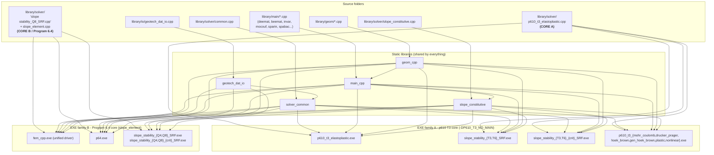
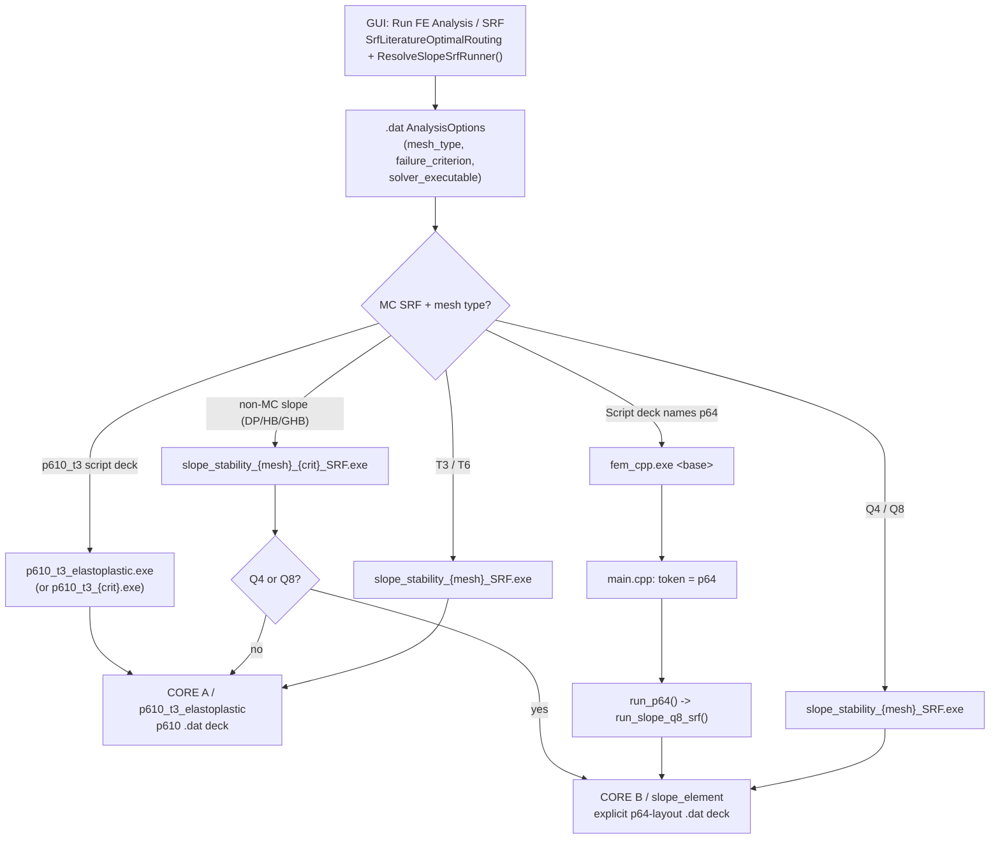

# Solver architecture: how the C++ `.cpp` solvers are linked into `.exe`, and how the app routes to them

Mapped from `CMakeLists.txt`, `library/solver/main.cpp`, and the GUI router
`X2D_GUI/Backend/P610AnalysisOptions.cs`.

## Summary

- Every solver executable statically links the same 5 building-block libraries:
  `geom_cpp`, `main_cpp`, `geotech_dat_io`, `solver_common`, `slope_constitutive`.
- There are **two independent solver cores**:
  - **Core A** — `library/solver/p610_t3_elastoplastic.cpp` (staged-excavation elastoplastic).
    The `T3/T6` branded SRF exes are thin wrappers that recompile this core with
    `-DP610_T3_NO_MAIN`.
  - **Core B** — `library/solver/slope stability_Q8_SRF.cpp` + `slope_element.cpp`
    (Smith & Griffiths Program 6.4, viscoplastic SRF). `fem_cpp`, `p64`, and all `Q4/Q8`
    branded SRF exes use this core.
- `Q8` deliberately comes from **Core B**, never Core A (Core A's Q8 element is broken —
  returns zero stress / diverges; the shipped `slope_stability_Q8_SRF.exe` is built from
  Core B).
- A standard Mohr-Coulomb slope SRF run from **Run FE Analysis** is routed by the GUI through
  **`slope_stability_{Mesh}_SRF.exe`** (literature-optimal core per mesh), not `fem_cpp p64`:
  - **T3 / T6** → Core A (`p610_t3_elastoplastic`) + p610 `.dat` deck
  - **Q4 / Q8** → Core B (`slope stability_Q8_SRF` / `slope_element`) + explicit p64-layout `.dat` deck
    (`slope_stability_{Q4,Q8}_SRF.exe` in `library/solver/SRF/`)
- The unified `fem_cpp.exe → p64` path remains available for Script Editor decks that name
  `p64` explicitly, but it is not the default for GUI SRF runs.

## A. Build / link graph — `.cpp` -> static libs -> `.exe`

## B. Runtime routing — how the app selects an `.exe`

## C. Where things live

| Item | Path |
|---|---|
| Core A source | `library/solver/p610_t3_elastoplastic.cpp` |
| Core B source | `library/solver/slope stability_Q8_SRF.cpp`, `library/solver/slope_element.cpp` |
| Unified driver dispatch | `library/solver/main.cpp` (`p64`->`run_p64`->`run_slope_q8_srf`) |
| Failure criteria | `library/solver/slope_constitutive.cpp` |
| `.dat` parsing | `library/io/geotech_dat_io.cpp` |
| FE primitives (S&G) | `library/main/*.cpp` |
| Deployed exes | `library/solver/SRF/` (T3/T6/Q4/Q8 SRF), `library/solver/Q4-Q8 SRF/` (`fem_cpp`, `p64`), `library/solver/Structural-Static Elasticity/` (p610) |
| GUI routing | `X2D_GUI/Backend/P610AnalysisOptions.cs`, `SrfLiteratureOptimalRouting.cs` |

## Notes / caveats

- The branded `T3/T6` SRF exes and the Core B `Q4/Q8` path are **different numerical cores**. For the same Mohr-Coulomb slope, Core A and Core B can give slightly
  different Factor-of-Safety values (e.g. T6 ~1.40 via Core A's lumped gravity vs ~1.32
  via Core B's consistent gravity) because of differences in gravity load lumping and the
  viscoplastic convergence handling.
- Q4/Q8-branded SRF exes deploy to `library/solver/SRF/` alongside T3/T6.
